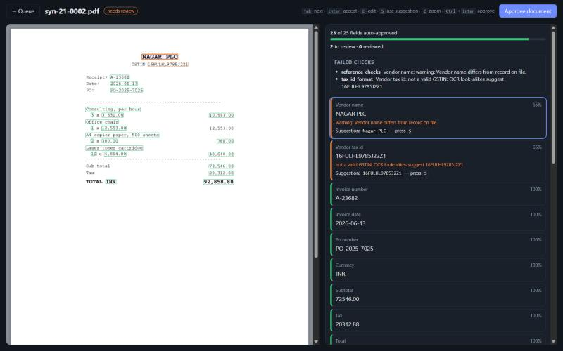

# DocFlow

DocFlow turns scanned invoices and receipts into validated, versioned JSON. It sends uncertain
fields to a human reviewer, and turns the reviewer's corrections into better extractor
versions. A new version goes live only if it beats the current one on a frozen evaluation set.

```
upload ─▶ OCR ─▶ LLM extraction ─▶ validation ─▶ approved ─▶ indexed for cited Q&A
                                        │
                                        ▼
                         review UI (low-confidence fields)
                                        │ corrections (append-only)
                                        ▼
             candidate extractor ─▶ evaluation gate ─▶ promoted or rejected
```



On a 41-invoice dev set: 97.9% of fields extracted correctly; every wrong field (18/18) was
sent to a person and every auto-approved field (854/854) was right.

## Status

Built in phases; each phase is usable and tested on its own.

| Phase | Scope | State |
|---|---|---|
| 1. Foundation | Workspace, config, versioned schemas, normalisation, Postgres schema with row-level security, API skeleton, Docker Compose | **Done** |
| 2. Ingestion and OCR | Upload API, object storage, per-stage queues, idempotent workers, OCR adapters, synthetic invoice generator | **Done** |
| 3. Extraction and confidence | Groq/OpenAI-compatible structured output, prompt builder, grounding to page boxes, calibrated confidence | **Done** |
| 4. Validation and review | Rule validators, tool-calling reference checks, routing, React review UI with box overlay | **Done** |
| 5. Evaluation and learning loop | Golden/dev sets, metrics, bootstrap promotion gate, few-shot learning from corrections | Next |
| 6. Retrieval and Q&A | Chunking, local embeddings, hybrid vector + keyword search, cited answers | |
| 7. Operations | Observability, cost controls, CI eval gate, Terraform (lean and full AWS modes) | |

## Run it locally

Requires [Docker Desktop](https://www.docker.com/products/docker-desktop/) and
[uv](https://docs.astral.sh/uv/).

```bash
cp .env.example .env                 # then set LLM_API_KEY (free key: console.groq.com)
docker compose up --build -d         # Postgres, S3Mock, ElasticMQ, migrations, API, OCR worker
docker compose logs migrate | grep "API key"   # first run only: save it as DOCFLOW_API_KEY in .env
```

Try the pipeline with synthetic invoices:

```bash
uv run python scripts/generate_invoices.py --n 12 --out data/synthetic
uv run python scripts/demo_upload.py data/synthetic --until extracted
```

- Review UI: http://localhost:8080 (paste the API key)
- API docs: http://localhost:8000/docs
- Health: http://localhost:8000/healthz, readiness (database): http://localhost:8000/readyz
- Worker logs (JSON, one line per stage event): `docker compose logs -f worker-ocr`

| Service | Port | Role |
|---|---|---|
| api | 8000 | FastAPI |
| worker-ocr | none | OCR queue consumer (Tesseract 5.5) |
| worker-extract | none | LLM extraction (Groq gpt-oss-120b + gpt-oss-20b second opinion) |
| worker-validate | none | Rules, tool-calling reference checks, routing |
| web | 8080 | Review UI (React) behind nginx, proxying `/v1` to the API |
| db | 5432 | Postgres 16 + pgvector |
| s3mock | 9090 | Local S3 (Adobe S3Mock) |
| elasticmq | 9324 | Local SQS with dead-letter queues |

## Develop and test

```bash
uv sync                              # Python 3.12 venv with every workspace package
uv run pytest                        # DB and emulator tests run when the compose stack is up
uv run ruff check . && uv run mypy packages/docflow_core/src apps/api/src apps/worker/src scripts
cd apps/web && npm ci && npm test && npm run typecheck   # review UI
```

## Repository layout

```
apps/api/            FastAPI app: upload, document status, presigned page images
apps/web/            review UI: React + Vite + TypeScript, served by nginx
apps/worker/         queue consumers; runner.py is the shared retry/idempotency contract
  stages/ocr.py      rasterise, clean up, OCR, store page images + OCR JSON
  stages/extract.py  LLM extraction with the active extractor version, usage metering
  stages/validate.py rules + reference checks -> approved or needs review
packages/docflow_core/
  config.py          one settings class; every setting is an environment variable
  normalise.py       amount/date/name normalisation shared by validators and evals
  schemas/           versioned Pydantic document schemas + registry
  db/                SQLAlchemy models, sessions, SQL migrations with RLS
  ocr/               engine interface, Tesseract/Textract adapters, rasterise, preprocess
  extract/           prompt, OpenAI-compatible client, grounding, confidence, versions
  eval/match.py      is each extracted field right (normalised comparison)
  validate/          rules, tool-calling reference checks, routing
  review.py          accept/edit/approve with re-validation
  storage.py         S3 key layout, S3 + in-memory stores
  queue.py           stage messages, SQS + in-memory queues
  security.py        API keys (only hashes are stored)
  taxid.py           GSTIN format and check character
docker/              Postgres init, ElasticMQ queue + DLQ config
scripts/
  seed.py            demo tenant, admin and API key
  generate_invoices.py  synthetic invoices with exact labels, three layouts, scan noise
  demo_upload.py     upload a folder through the API and wait for the pipeline
  calibrate.py       fit confidence calibration + review threshold on a dev set
  admin.py           extractor versions, reprocess a stage, inspect/redrive/purge a DLQ
  seed_reference.py  vendors and POs with known discrepancies, plus expected findings
  routing_report.py  catch rate, auto-approve precision, review load, reference accuracy
docs/                design notes per phase
```

## Design principles

| Principle | Where it lives |
|---|---|
| Everything is versioned | `schema_versions`, `extractor_versions`; extractions record which version produced them |
| Corrections are append-only | No UPDATE/DELETE grant for the app, plus a trigger that stops even the owner |
| Idempotent stages | `stage_runs` unique on (document, stage); duplicate uploads unique on (tenant, sha256) |
| Swappable providers | OCR, LLM and embeddings behind small interfaces, chosen by configuration |
| Gated model changes | Partial unique index: at most one active extractor per document type |
| Isolation in the database | Postgres row-level security on every tenant table, app role without BYPASSRLS |
| Synthetic or public data only | No real customer documents are stored or evaluated |

The reasoning behind each choice is in the phase notes:
[phase 1, foundation](docs/phase-1-foundation.md) ·
[phase 2, ingestion and OCR](docs/phase-2-ingestion-ocr.md) ·
[phase 3, extraction and confidence](docs/phase-3-extraction.md) ·
[phase 4, validation and review](docs/phase-4-validation-review.md).
