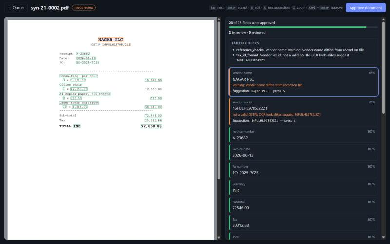

# Phase 4: Validation, reference checks and human review

Phase 4 decides which fields a person must look at, and gives that person a screen where
clearing a document takes a few keystrokes.

```
extraction ─▶ 7 deterministic rules ─┐
           ─▶ reference checks (LLM + 2 read-only tools on the tenant's own data) ─┤
                                                                                     ▼
              each field: calibrated confidence + its rule results ─▶ auto_approved | needs_review
                                                                                     ▼
              approved ─▶ [index queue]        needs_review ─▶ review UI ─▶ corrections (append-only)
```



## 1. Rules (`validate/rules.py`)

Pure functions from the extracted values to results; each result names the fields it covers.

| Rule | Check |
|---|---|
| line_items_sum | row amounts add up to the subtotal (or the total on receipts without tax) |
| total_consistency | subtotal + tax = total, within 0.01 |
| row_arithmetic | quantity × unit price = amount on every row |
| valid_date | parses, not in the future, not older than 3 years |
| known_currency | allowed code, and a matching symbol or code is printed on the page |
| required_fields | every required value is present |
| tax_id_format | GSTIN format and check character, with a repair suggestion |

On version 2's 41 dev extractions the rules flagged **18 of 21 wrong fields and 0 of 980
correct ones**: they fire on errors and stay quiet otherwise, which is what makes them safe to
feed into confidence.

### The GSTIN check and repair

Phase 3 left tax IDs at 66% accuracy with high confidence: OCR swaps look-alike characters and
both models copy the misread. Every GSTIN position has a known class (digit, letter, the fixed
`Z`), so a misread usually breaks the format or the check character, and the format says which
look-alike was meant. `repair_gstin` undoes those swaps, and doubled glyphs, and returns a
candidate only if exactly one valid GSTIN results.

| On 32 dev tax IDs | |
|---|---|
| wrong IDs caught by the check character | 14 / 14 |
| correct IDs wrongly flagged | 0 / 18 |
| wrong IDs repaired to the exact truth | 12 / 14 |
| wrong repairs suggested | 0 |

The repair is a **suggestion** the reviewer accepts with one key (`S`), not an automatic
change. It has never been wrong on the dev set, but 14 cases is not enough evidence to let
software rewrite a tax ID unseen. Auto-applying it is a decision to take later, with a larger
labelled sample behind it.

## 2. Reference checks with tool calling (`validate/reference.py`)

The model gets the extracted vendor, tax ID, PO number, total and currency, plus two tools:

- `lookup_vendor(name?, tax_id?)`: up to 3 closest vendors on file (pg_trgm similarity, or an
  exact tax-ID match);
- `check_purchase_order(po_number, total?, currency?, vendor_name?)`: the order, whether
  vendor, total and currency match, and the difference.

Guard rails:

- Tools are **read-only** and run inside the tenant's own database session. The model never
  passes a tenant id, and row-level security would stop it anyway (tested).
- Arguments are validated against the tool schema before anything runs. Unknown tools, extra
  arguments (say, a `tenant_id`) or bad types go back to the model as an error.
- Tool results are sent as data, and the prompt says so.
- At most 3 rounds. Findings only lower confidence and show in the panel; nothing is changed.

The five design-doc cases (exact match, close spelling, unknown vendor, PO total off, PO of
another vendor) pass against the **live** model (`RUN_LLM_TESTS=1 pytest -m llm`).

**Why a model and not plain code?** The lookups and comparisons could be coded. The vendor
decision is fuzzy ("Acme Traders Pvt Ltd" vs "ACME Trading Co." on file), and the agent loop is
a pattern worth having under tight guard rails and tests. A coded baseline is the comparison
to run if the model's accuracy ever disappoints.

## 3. Routing (`validate/apply.py`)

Each field's stored signals get the rule results added (`validators_passed`), are re-scored
through the extractor version's calibration, and the field becomes `auto_approved` (confidence
at or above the threshold and no failed rule) or `needs_review`. A document is approved only
when no field needs review and it has no document-level issue.

Threshold: `REVIEW_THRESHOLD_<TYPE>` when an operator sets it, else the one calibrated with
the extractor version (0.9286 for version 3), else 0.9.

## 4. Review API and UI

| Endpoint | |
|---|---|
| `GET /v1/review/queue` | documents waiting, oldest first, with fields to check |
| `GET /v1/extractions/{id}` | fields with value, confidence, page, box, checks, status |
| `POST /v1/extractions/{id}/corrections` | accept or edit one field |
| `POST /v1/documents/{id}/approve` | approve; 409 lists what is still pending |

Every accept or edit appends a row to `corrections` (old value, new value, reviewer, seconds
spent). An accept with no change is stored too, as a positive label for phase 5. Edits are
parsed exactly like model replies (`"Rs. 1,180.00"` becomes `1180.00`). After each correction
the rules run again, so **fixing one number clears the flags it caused**: correct a wrong
total and subtotal and tax return to auto-approved without being touched (tested). Viewers can
read but not change anything (403); other tenants get 404.

The UI (`apps/web`, React + Vite + TypeScript, no component library) shows the page with an
SVG box per field (green auto-approved, orange to review, blue reviewed) beside the field list.
Clicking a box focuses its field; focusing a field scrolls the page to its box. Keyboard:
`Tab` next to review, `Enter` accept, `E` edit, `S` use suggestion, `Z` zoom,
`Ctrl+Enter` approve and open the next document. nginx serves it on :8080 and proxies `/v1`,
so the browser stays on one origin.

## 5. Results on the dev set (extractor version 3)

41 documents, 1,001 fields, scored against labels with `scripts/routing_report.py`:

| | |
|---|---|
| wrong fields sent to review (catch rate) | **18 / 18 (100%)** |
| auto-approved fields that are right | **854 / 854 (100%)** |
| fields a person has to look at | 147 / 1,001 (14.7%) |
| documents approved with no human touch | 3 / 41 |
| reference checks exactly as expected | 34 / 41 documents (21/26 flags, 3 false flags) |

Nothing wrong slipped through, at the cost of review work. Grouping fields by their evidence
shows where that work comes from:

| Evidence | Fields | Correct | Sent to review |
|---|---|---|---|
| exact, models agree, rules pass, OCR ≥ 0.90 | 565 | 100% | 0% |
| exact, no second opinion (daily quota hit), OCR ≥ 0.90 | 135 | 100% | ~29% |
| absent, both models agree | 22 | 100% | 100% |
| exact, agree, rules pass, OCR < 0.80 | 17 | 100% | 100% |
| exact, agree, rules **fail**, OCR < 0.80 | 8 | 12.5% | 100% |

About 60 provably correct fields are reviewed because the hand-made raw score from phase 3 gives
OCR confidence too much weight and treats an agreed absence as weak, and because the second
opinion went missing once the free quota ran out. When the models agree and the rules pass,
the value was right every time. The fix is to **learn** the score from these signals instead
of hand-tuning it. That is deliberately left for phase 5: a learned scorer is a new extractor
version, and phase 5 builds the frozen evaluation set and the promotion gate that must judge it
on data it was not fitted on.

## 6. What went wrong, and what changed because of it

- **A test was eating the pipeline's messages.** The phase 2 emulator test used the real
  validate queue and "drained" it by receiving without deleting. Every run counted as a
  delivery attempt, and after three runs SQS dead-lettered 92 real messages. The test now
  creates its own throwaway queue, and `admin.py dlq --stage <s> [--redrive|--purge]` lets an
  operator inspect and recover a dead-letter queue.
- **The free daily quota ran out mid-run** (gpt-oss-20b: 200,000 tokens per day; roughly 40
  documents at about 4,800 tokens each with second opinion plus reference checks). Six
  documents failed at validation. A reference check is extra evidence, so a provider error
  must not fail a document: it now becomes a document-level issue ("reference checks
  unavailable") and the document goes to review, which is also how an unfinished tool loop is
  handled. `admin.py reprocess --reason RateLimitError` re-ran exactly those six.
- **nginx returned 502 after the API container was recreated**: it had resolved `api` once at
  start-up. It now resolves through Docker's DNS on each request (verified by force-recreating
  the API).

## Deviations from the design doc

- Added `row_arithmetic`, and a GSTIN check character plus repair beyond the format check.
- `check_purchase_order` takes the vendor name, so the vendor-on-PO comparison is computed by
  the tool, not guessed by the model.
- A reference check that cannot run sends the document to review rather than passing silently.
- Document-level issues live in a new `extractions.issues` column (migration 0002).
